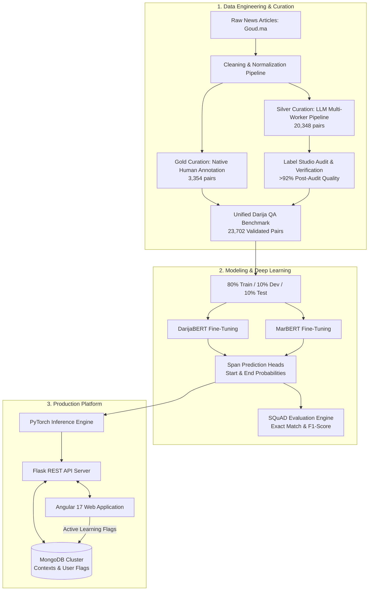

# 🇲🇦 Moroccan Darija Contextual Question Answering System

[](https://opensource.org/licenses/MIT)
[](https://www.python.org/)
[](https://pytorch.org/)
[](https://huggingface.co/)
[](https://angular.dev/)
[](https://flask.palletsprojects.com/)
[](https://www.mongodb.com/)
[](https://github.com/nizarmadih/Frontend-Contextual-QA-Project/pulls)

> An end-to-end contextual extractive Question Answering platform and benchmark dedicated to **Moroccan Darija (الدارجة المغربية)**. Featuring the first large-scale benchmark of **23,702 validated QA pairs**, fine-tuned dialectal Transformer models (**DarijaBERT** & **MarBERT**), and a full-stack production application (Flask + Angular 17 + MongoDB) with human-in-the-loop active learning.

---

## 📑 Table of Contents

- [Overview &amp; Motivation](#-overview--motivation)
- [Key Features](#-key-features)
- [System Architecture](#-system-architecture)
- [Dataset Benchmark](#-dataset-benchmark)
  - [Source &amp; Corpus Characteristics](#source--corpus-characteristics)
  - [Preprocessing &amp; Normalization Pipeline](#preprocessing--normalization-pipeline)
  - [Gold Standard (Expert Human Annotation)](#gold-standard-expert-human-annotation)
  - [Silver Standard (LLM Generation with Human Audit)](#silver-standard-llm-generation-with-human-audit)
  - [Dataset Statistics &amp; Analysis](#dataset-statistics--analysis)
- [Modeling &amp; Training](#-modeling--training)
  - [Span Prediction Formulation](#span-prediction-formulation)
  - [Dialectal Transformer Architectures](#dialectal-transformer-architectures)
  - [Hyperparameters &amp; Training Protocol](#hyperparameters--training-protocol)
- [Evaluation &amp; Benchmark Results](#-evaluation--benchmark-results)
  - [Evaluation Protocol](#evaluation-protocol)
  - [Comparative Analysis](#comparative-analysis)
  - [Error Taxonomy &amp; Failure Analysis](#error-taxonomy--failure-analysis)
- [Full-Stack Platform](#-full-stack-platform)
  - [Backend Architecture](#backend-architecture)
  - [Frontend Architecture](#frontend-architecture)
  - [Active Learning Feedback Loop](#active-learning-feedback-loop)
- [REST API Reference](#-rest-api-reference)
- [Repository Structure](#-repository-structure)
- [Getting Started](#-getting-started)
  - [Prerequisites](#prerequisites)
  - [Backend Setup](#1-backend-setup)
  - [Frontend Setup](#2-frontend-setup)
  - [Model Checkpoints](#3-model-checkpoints)
- [Scientific References](#-scientific-references)

---

## 🌍 Overview & Motivation

Moroccan Darija is spoken natively by over **36 million people**. Despite its ubiquity across digital media, social networks, and everyday communication, it remains an underserved, **low-resource language** in natural language processing (NLP):

- **Non-Standardized Orthography**: High orthographic variation across speakers and regions.
- **Diglossia and Script Variance**: Dual-script usage across Arabic script and Latin transliteration (*Arabizi*), with frequent code-switching with Modern Standard Arabic (MSA) and French.
- **Scarcity of Supervised Benchmarks**: Prior to this project, there was no dedicated, large-scale dataset for extractive contextual Question Answering in Moroccan Darija.

This project delivers an open, production-grade ecosystem to solve this challenge:

1. **The first curated benchmark dataset** of **23,702 QA pairs** for Moroccan Darija.
2. **Fine-tuned Transformer models** optimized for Moroccan dialectal morphology.
3. **An enterprise-grade full-stack interface** supporting real-time text analysis, confidence scoring, and interactive error flagging for continuous model improvement.

---

## ⚡ Key Features

- **Large-Scale High-Precision Benchmark**:
  - **3,354 Gold QA pairs**: 100% manually curated by native speakers with strict span constraints.
  - **20,348 Silver QA pairs**: Generated via Google Gemini models (`gemini-2.5-pro`, `gemini-2.0-flash`, `gemini-2.5-flash-lite`).
  - **Over 8,000 samples audited** via Label Studio, verifying an overall corpus accuracy of **>92%**.
- **State-of-the-Art Transformers**:
  - Fine-tuned **DarijaBERT** (monodialectal Moroccan WordPiece tokenizer) and **MarBERT** (128GB multi-dialectal pre-training).
  - Outperforms traditional information retrieval baselines (TF-IDF, BM25, FastText).
- **Comprehensive Error Taxonomy**:
  - Detailed characterization of boundary offsets (+1/-1 token shifts), modifier attachments, and dialectal orthographic drifts.
- **Production Full-Stack Application**:
  - High-performance Flask REST microservice with PyTorch and Hugging Face runtime.
  - MongoDB database tracking contexts, conversations, and flagged feedback.
  - Modern Angular 17 UI featuring dark-mode glassmorphic aesthetics, RTL/LTR support, and interactive QA inspection.

---

## 🏗 System Architecture



---

## 📊 Dataset Benchmark

### Source & Corpus Characteristics

The benchmark was built upon journalistic data from **[Goud.ma](https://www.goud.ma)**, one of Morocco's primary digital news platforms authored in native Darija using the Arabic script.

| Parameter                   | Specification                                                                                                            |
| :-------------------------- | :----------------------------------------------------------------------------------------------------------------------- |
| **Source Platform**         | Goud.ma (Hugging Face `Goud/Goud-sum` + Scraped Articles)                                                                |
| **Temporal Coverage**       | September 2024 – January 2026                                                                                            |
| **Topics Covered**          | Breaking News (*Ash Waqe3*), Politics (*Rasmia*), Sports (*Code Sport*), Culture (*Media wa Thaqafa*), Opinions (*Araa*) |
| **Linguistic Authenticity** | Written natively in Moroccan Darija by professional journalists                                                          |
| **Context Selection**       | Lead paragraph extracted according to the journalistic inverted-pyramid structure                                        |
| **Semantic Density**        | High frequency of named entities (public figures, geopolitical entities, dates, numeric figures)                         |

---

### Preprocessing & Normalization Pipeline

A standardized data preprocessing pipeline was deployed to prepare texts for extractive span identification:

1. **Lead Paragraph Extraction**: The first paragraph was selected as it systematically answers core journalistic interrogatives (*Who, What, Where, When*).
2. **Noise Filtering**:
   - Stripping of external links and URLs using regular expressions.
   - Removal of emojis and non-Arabic Unicode symbols.
   - Elimination of author bylines and metadata signatures (*"Goud.ma"*).
   - Pruning of repetitive punctuation and non-informative fragments.
3. **Deduplication**: Hash-based deduplication preventing sample leakage across splits.
4. **Arabic Normalization**:
   - Removal of Arabic vocalization diacritics (*Tashkeel*).
   - Removal of elongation characters (*Tatweel* / *Kashida* `U+0640`).
5. **Length Winsorization**: Applied quantile trimming (0.01 – 0.99 quantiles) to remove length outliers and ensure optimal sequence utilization.

---

### Gold Standard (Expert Human Annotation)

The Gold Standard serves as the canonical ground truth reference:

- **Volume**: **3,354 question-answer pairs** across **3,266 distinct contexts**.
- **Strict Extractive Constraint**: Answers are verbatim substrings extracted directly from the context text (zero paraphrase allowed).
- **Minimal Answer Span**: Annotators selected the tightest informative boundary around the target entity.
- **Permitted Question Types**: *Who* (شكون), *What* (شنو), *Where* (فين), *When* (فوقاش / وقتـاش / فيقاش), *How Many / How Much* (شحال), *Which* (أشمن).
- **Forbidden Categories**: Subjective, non-extractive queries (*Why* / *How*).
- **Zero External Knowledge**: Guarantees that every target answer is fully self-contained in the input passage.

---

### Silver Standard (LLM Generation with Human Audit)

To achieve the volume required to train deep bidirectional Transformers, semi-automated generation was executed using Google Gemini models:

- **Models Deployed**: `gemini-2.5-pro`, `gemini-2.0-flash`, and `gemini-2.5-flash-lite`.
- **Generation Scale**: Multi-worker pipeline operating across 6 distributed API keys, processing ~3,000 contexts daily. Over 100,000 raw candidate pairs were produced and filtered down to **20,348 validated pairs**.
- **Human-in-the-Loop Audit**: Over **8,000 pairs** underwent systematic manual auditing in [Label Studio](https://labelstud.io/) using a custom verification interface. Erroneous samples were either boundary-corrected or purged, achieving an audited precision of **>92%**.

---

### Dataset Statistics & Analysis

#### Composition Breakdown

| Subset              | Sample Count | Proportion  | Method                                    |
| :------------------ | :----------: | :---------: | :---------------------------------------- |
| **Gold Standard**   |  **3,354**   | **14.15%**  | 100% Native Speaker Manual Annotation     |
| **Silver Standard** |  **20,348**  | **85.85%**  | LLM Generation + Label Studio Human Audit |
| **Total Benchmark** |  **23,702**  | **100.00%** | Unified Validated Corpus                  |

#### Length Statistics (Words)

| Field        |  Min  |  Max  |   Mean    |
| :----------- | :---: | :---: | :-------: |
| **Context**  |   4   |  593  | **32.13** |
| **Question** |   1   |  25   | **8.61**  |
| **Answer**   |   1   |  28   | **2.92**  |

#### Top 10 Interrogative Question Types

|  Rank  | Particle (Darija)     | Meaning             | Percentage |
| :----: | :-------------------- | :------------------ | :--------: |
| **1**  | **شكون** (*chkon*)    | Who                 |   21.8%    |
| **2**  | **شنو** (*chno*)      | What                |   21.2%    |
| **3**  | **فين** (*fin*)       | Where               |   12.4%    |
| **4**  | **شحال** (*ch7al*)    | How many / How much |   12.4%    |
| **5**  | *chkoun* (Arabizi)    | Who                 |    8.9%    |
| **6**  | *chno* (Arabizi)      | What                |    7.3%    |
| **7**  | **فيقاش** (*fi9ach*)  | When                |    4.7%    |
| **8**  | **ف** (*f...*)        | In / At             |    4.5%    |
| **9**  | **وقتاش** (*w9tach*)  | When                |    3.7%    |
| **10** | **فوقاش** (*fouqach*) | When                |    3.0%    |

#### Script Distribution

- **Arabic Script**: **70.0%** (5.68% exhibiting mixed Arabic/Latin code-switching).
- **Pure Arabizi (Latin script)**: **30.0%**.

---

## 🧠 Modeling & Training

### Span Prediction Formulation

Contextual extractive Question Answering is framed as a token classification task over a joint sequence:

$$
\text{Input} = [\text{CLS}] \circ q_1, \dots, q_m \circ [\text{SEP}] \circ c_1, \dots, c_n \circ [\text{SEP}]
$$

Representations $\mathbf{H} \in \mathbb{R}^{L \times d}$ output by the Transformer encoder are projected via two linear classification layers:

$$
P_{\text{start}} = \text{softmax}(\mathbf{H} \mathbf{W}_{\text{start}}), \quad P_{\text{end}} = \text{softmax}(\mathbf{H} \mathbf{W}_{\text{end}})
$$

The predicted answer span $(s, e)$ is obtained by maximizing:

$$
(s^*, e^*) = \arg\max_{s \le e \le s + L_{\max}} (P_{\text{start}}(s) \cdot P_{\text{end}}(e))
$$

### Dialectal Transformer Architectures

1. **DarijaBERT**:
   - Monodialectal BERT model pre-trained specifically on Moroccan Darija (~100M tokens from Moroccan YouTube and Twitter data).
   - Features a specialized WordPiece vocabulary capturing dialect-specific roots and common French borrowings.
2. **MarBERT**:
   - Multi-dialectal Arabic BERT pre-trained on 128GB of Arabic tweets (~15.6 billion tokens, 100k vocabulary).
   - Offers broad linguistic coverage and robust contextual embeddings across Maghrebi dialects.

### Hyperparameters & Training Protocol

```python
# Fine-Tuning Setup
learning_rate        = 3e-5
batch_size           = 16
epochs               = 3
max_sequence_length  = 512    # Inference length: 384
warmup_steps         = 500
weight_decay         = 0.01
optimizer            = "AdamW"
loss                 = "CrossEntropyLoss (Start & End)"
```

#### Dataset Partitioning

| Partition                  |  Samples   | Percentage |
| :------------------------- | :--------: | :--------: |
| **Training Set (`train`)** |   18,961   |    80%     |
| **Validation Set (`dev`)** |   2,370    |    10%     |
| **Test Set (`test`)**      |   2,371    |    10%     |
| **Total**                  | **23,702** |  **100%**  |

---

## 📈 Evaluation & Benchmark Results

### Evaluation Protocol

Evaluations are conducted following the standard **SQuAD** evaluation benchmark:

1. **Exact Match (EM)**: Measures the percentage of predictions that match the ground truth string exactly:

   $$
   \text{EM} = \mathbb{I}(\text{normalize}(\hat{y}) = \text{normalize}(y))
   $$
2. **F1-Score**: Measures the harmonic mean of token-level precision and recall:

   $$
   \text{F1} = \frac{2 \cdot \text{Precision} \cdot \text{Recall}}{\text{Precision} + \text{Recall}}
   $$

   *Standard normalization includes lowercasing, whitespace collapse, punctuation stripping, and Arabic character normalization.*

### Comparative Analysis

The fine-tuned Transformer models were benchmarked against traditional Information Retrieval and word embedding baselines:

- **TF-IDF**: Suffers from extreme lexical sparsity due to dialectal morphology.
- **BM25**: Stronger on exact named-entity queries, but cannot perform fine-grained boundary extraction.
- **FastText**: Captures sub-word morphology, but fails to model bidirectional context dependencies.
- **DarijaBERT & MarBERT**: Significantly outperform lexical baselines, achieving robust extraction of minimal semantic spans.

### Error Taxonomy & Failure Analysis

In-depth qualitative inspection of validation errors revealed four recurring patterns:

| Error Class                    | Root Cause                                                            | Example Case                                                  |
| :----------------------------- | :-------------------------------------------------------------------- | :------------------------------------------------------------ |
| **Boundary Offset (+1 Token)** | Capture of adjacent temporal adverbs / deictic markers                | Predicted: `اليوم 27 فبراير 2025`Gold: `27 فبراير 2025`       |
| **Modifier Inclusion**         | Inclusion of trailing descriptive adjectives with named entities      | Predicted: `باريس سان جيرمان الفرنسي`Gold: `باريس سان جيرمان` |
| **Clause Extension**           | Model predicts a full sentence instead of the minimal entity          | Occurs in complex relative clauses                            |
| **Orthographic Shift**         | Non-standard dialectal spelling differences between context and query | e.g., `دابا` vs `دبا`, `شكون` vs `اشكون`                      |

---

## 💻 Full-Stack Platform

The repository provides a complete, production-ready question answering web application:

### Backend Architecture

- **API Controller**: [`Backend/controller.py`](<file:///d:/9raya/IID2/S2/Text%20Mining/Whole-Project/Backend/controller.py>)
- **Tech Stack**: Python, Flask, PyTorch, Hugging Face Transformers, PyMongo.
- **Model Server**: Runs local Transformer inference with softmax confidence calculation and token-to-character span alignment.
- **Database**: MongoDB instance managing conversation sessions, stored contexts, and flagged predictions.

### Frontend Architecture

- **Framework**: Angular 17 standalone component architecture with reactive state management ([`Frontend/src/app/`](<file:///d:/9raya/IID2/S2/Text%20Mining/Whole-Project/Frontend/src/app>)).
- **Key Views**:
  - `DashboardComponent`: Real-time analytics banner, usage cards, and high-level benchmark statistics.
  - `ChatComponent`: Interactive conversational interface with confidence gauges and answer extraction highlights.
  - `SidebarComponent`: Context manager and conversational history browser.
  - `ContextModalComponent`: Custom interface for pasting or uploading raw Darija text passages.
  - `FlagModalComponent`: In-app feedback dialog allowing users to flag incorrect predictions.

### Active Learning Feedback Loop

When the model produces an imprecise extraction, users can submit feedback directly from the chat UI:

- Submissions record `convo_id`, `qa_id`, `model_answer`, `suggested_answer`, and `flag_type`.
- Flagged entries are stored in MongoDB (`flagged` collection), creating a human-in-the-loop active learning queue for continuous model fine-tuning.

---

## 📡 REST API Reference

The Flask backend serves JSON endpoints on `http://localhost:5000`:

### 1. Ingest New Context

```http
POST /add
Content-Type: application/json

{
  "context": "توفي المغني الأمريكي إيرل كارجتون عن عمر يناهز 73 سنة..."
}
```

**Response (200 OK)**:

```json
{
  "success": true,
  "inserted_id": "6640abc...",
  "convo_id": "e2d76a2e-4b68-45a8-9d51-912f27eb622f"
}
```

### 2. Submit Question

```http
POST /question
Content-Type: application/json

{
  "id": "e2d76a2e-4b68-45a8-9d51-912f27eb622f",
  "question": "شحال كان فعمرو إيرل كارجتون فاش مات؟"
}
```

**Response (200 OK)**:

```json
"73 سنة"
```

### 3. Flag Imprecise Prediction

```http
POST /flag
Content-Type: application/json

{
  "id": "e2d76a2e-4b68-45a8-9d51-912f27eb622f",
  "qa_id": "f51950c4-9721-4d1d-9377-2f1f5efc354e",
  "model_answer": "اليوم 27 فبراير 2025",
  "suggested_answer": "27 فبراير 2025",
  "flag_type": "boundary_error"
}
```

---

## 📁 Repository Structure

```
.
├── README.md                      # Project documentation
├── .gitattributes                 # Git LFS & line ending rules
│
├── Backend/                       # Flask REST API & PyTorch Model
│   ├── controller.py              # Main Flask server, routes, and inference handler
│   └── model/                     # Production Transformer checkpoint
│       ├── config.json            # Model architecture configuration
│       ├── model.safetensors      # Fine-tuned model weights (~650MB)
│       ├── tokenizer.json         # Tokenizer vocabulary
│       └── tokenizer_config.json  # Tokenizer settings
│
├── Frontend/                      # Modern Angular 17 Web Application
│   ├── angular.json               # Angular workspace configuration
│   ├── package.json               # Dependencies and scripts
│   ├── proxy.conf.json            # Backend proxy configuration (port 5000)
│   ├── src/
│   │   ├── index.html             # Application entry point
│   │   ├── styles.css             # Design system tokens and styling
│   │   └── app/
│   │       ├── app.component.ts   # Root container component
│   │       ├── components/        # Chat, dashboard, sidebar, and modals
│   │       ├── models/            # TypeScript data interfaces
│   │       └── services/          # State management & HTTP services
│
└── data/                          # Dataset, Analysis & Experiment Notebooks
    ├── final_analysis.ipynb       # Exploratory analysis & corpus statistics
    ├── Training-models.ipynb      # Training pipelines, baselines & evaluation
    ├── use_model.ipynb            # Interactive inference notebook
    ├── Models_version1.md         # Download links to additional checkpoints
    └── dataset/                   # Benchmark datasets
        ├── gold_standard.csv      # 3,354 human-annotated QA pairs (CSV)
        ├── gold_standard.json     # 3,354 human-annotated QA pairs (JSON)
        ├── silver_standard.csv    # 20,348 audited QA pairs (CSV)
        ├── silver_standard.json   # 20,348 audited QA pairs (JSON)
        ├── data1/                 # Data curation partition 1
        ├── data2/                 # Data curation partition 2
        └── data3/                 # Data curation partition 3
```

---

## 🚀 Getting Started

### Prerequisites

- **Python**: `>= 3.10`
- **Node.js**: `>= 18.x` and **npm**: `>= 9.x`
- **MongoDB**: Local daemon running at `mongodb://localhost:27017` or a MongoDB Atlas URI
- **Hardware**: GPU recommended for high-throughput inference (CPU execution is fully supported)

---

### 1. Backend Setup

```bash
# Navigate to the Backend folder
cd Backend

# Create and activate a virtual environment
python -m venv venv
# On Windows:
venv\Scripts\activate
# On Linux/macOS:
source venv/bin/activate

# Install required dependencies
pip install flask flask-cors pymongo torch transformers

# Ensure MongoDB is running:
# mongod --dbpath /path/to/data/db

# Launch the Flask API server
python controller.py
```

The backend API server will start on `http://localhost:5000`.

---

### 2. Frontend Setup

```bash
# In a new terminal, navigate to the Frontend directory
cd Frontend

# Install node dependencies
npm install

# Start the Angular development server with backend proxying
npm run dev
# Or:
npm start
```

Open your browser and navigate to `http://localhost:4200`.

---

### 3. Model Checkpoints

The repository comes pre-packaged with the trained model in [`Backend/model/`](<file:///d:/9raya/IID2/S2/Text%20Mining/Whole-Project/Backend/model/>). For additional checkpoint downloads (best validation loss checkpoint vs. final epoch checkpoint), see [`data/Models_version1.md`](<file:///d:/9raya/IID2/S2/Text%20Mining/Whole-Project/data/Models_version1.md>):

- **DarijaBERT QA Best Model**: Checkpoint targeting minimum validation loss.
- **MarBERT QA Complete Model**: Complete checkpoint trained on the full 23.7k benchmark.

---

---

## 📚 Scientific References

1. Vaswani, A., et al. (2017). *Attention Is All You Need*. Advances in Neural Information Processing Systems (NeurIPS 2017). [arXiv:1706.03762](https://arxiv.org/abs/1706.03762).
2. Devlin, J., et al. (2019). *BERT: Pre-training of Deep Bidirectional Transformers for Language Understanding*. NAACL-HLT 2019. [arXiv:1810.04805](https://arxiv.org/abs/1810.04805).
3. Rajpurkar, P., Zhang, J., Lopyrev, K., & Liang, P. (2016). *SQuAD: 100,000+ Questions for Machine Comprehension of Text*. EMNLP 2016. [arXiv:1606.05250](https://arxiv.org/abs/1606.05250).
4. Abdul-Mageed, M., Zhang, C., Hashemi, A., & Elmadany, A. (2021). *ARBERT & MARBERT: Deep Bidirectional Transformers for Arabic*. ACL-IJCNLP 2021.
5. Gaanoun, K., et al. (2021). *DarijaBERT: A Pre-trained Language Model for Moroccan Arabic*.
